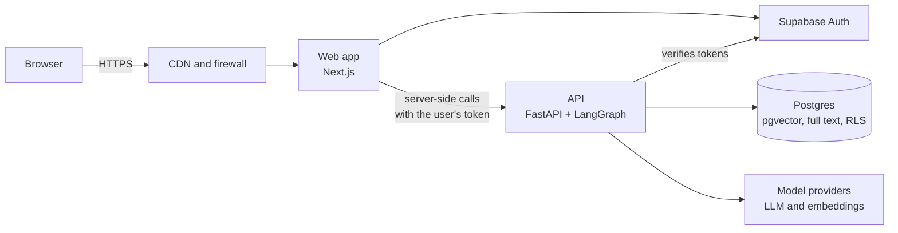
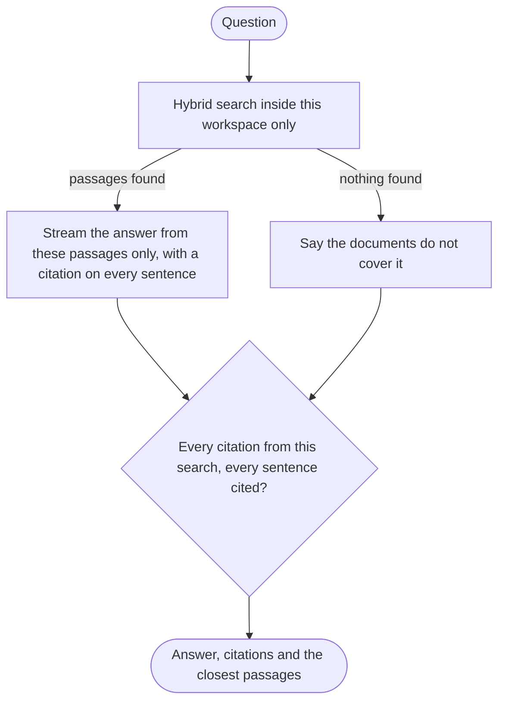

# Architecture

Status: draft 1, 2 November 2026. Decisions change through pull requests, and each change updates this file.

## Summary

A Next.js web app serves the pages and holds the user's session. When someone asks a question, the web server calls the Python API with that user's token. The API confirms who the user is and which workspace they may read, then runs a LangGraph agent. The agent searches that workspace's documents in Postgres, using vectors and keywords together, and asks a language model to answer from the passages it found and nothing else. The answer streams back as the model writes it, with a citation on every sentence. Once the answer is complete, a verification step checks each citation against its passage and flags any sentence the passage does not support. When someone uploads a file, the API keeps its text as passages, and a background task embeds them so they become searchable.

## Components

| Part | Job | Runs on |
| --- | --- | --- |
| Web app (`web/`) | Pages, forms, session cookies, per-IP rate limits, server-side calls to the API | Next.js on a free managed host with a CDN |
| API (`api/`) | Token checks, input validation, per-user rate limits, the agent, streaming answers | Python and FastAPI on a free host, packaged with Docker for development and CI |
| Agent | Turns the question into a search, retrieves, grades evidence, writes and verifies the cited answer | LangGraph, inside the API process |
| Background task | Embeds new passages after the upload response | Inside the API process. Free plans include no always-on background worker |
| Database | Workspaces, documents, passages, vectors, threads, audit log | Supabase Postgres with pgvector |
| File storage | None. Whence keeps the text it extracts, never the uploaded file | Nothing to run |
| Auth | Sign-up, sign-in, 2FA, password reset, Google sign-in | Supabase Auth |
| Model providers | Embeddings and answer generation | Cloudflare Workers AI: bge-small-en-v1.5 for embeddings, Llama 3.3 70B for answers |
| Observability | Logs, traces, errors, metrics, product analytics | Chosen later, if the demo needs them |

## How a question flows

1. The browser sends the question to our own web server. Same origin, so the browser makes no cross-origin call and CORS never comes into play.
2. The web server reads the session from an httpOnly cookie, applies per-IP rate limits, and calls `POST /v1/workspaces/{workspace_id}/ask` on the API with the access token.
3. The API verifies the token's signature, expiry, issuer and audience. It checks that the user belongs to the workspace and applies per-user rate limits.
4. Each database step (checking membership, searching) runs in its own short transaction, which sets the user ID that row-level security policies read. No transaction stays open while a model works, so a slow model call never holds a database connection.
5. The agent runs hybrid search inside the workspace, then either answers from the passages with citations, or says the documents do not cover it and shows the closest passages.
6. The API streams the answer to the web server with Server-Sent Events: `token` events while the model writes, then one `done` event with the citations, or one `error` event. The web server streams it on to the browser.
7. The check step keeps only citations that point at a passage this search returned, and marks the answer unverified when a sentence has no citation. Token counts and the estimated cost go to the log.

## How a document flows

1. The web server sends the file as the body of `POST /v1/workspaces/{workspace_id}/documents?name=...`. The file passes through the web server, so the web host's request limit also applies (4.5 MB on Vercel). The API checks the user's role and refuses a file name outside the allowlist (PDF, Markdown, text) before reading the body.
2. The API reads the body and stops as soon as it passes 10 MB. The content must match the name: a PDF must start with `%PDF-` and open in the parser, and Markdown and text must decode as UTF-8 with no null bytes.
3. A file the workspace already has, by SHA-256, returns the existing document, so a retried upload never makes a copy. Otherwise the API checks the workspace's storage quota, extracts the text with page numbers, and splits it into passages of up to 1,200 characters that never cross a page or a Markdown section. The document and its passages go in with one transaction. The file itself is never stored.
4. The response says `processing`. After it is sent, a background task embeds the passages in batches of 50 with Cloudflare Workers AI. Timeouts, rate limits and server errors retry with exponential backoff and jitter, up to 4 attempts per batch.
5. The document becomes `ready`, or `failed` if embedding fails, and then the person deletes it and uploads it again. If the server restarts during the task, the document stays `processing` (see decision 10).

## The agent

We use a fixed graph instead of a free-roaming agent. Every path makes at most one embedding call and one answer call, so cost and latency stay bounded, and we can test each node as a plain function.

Streaming forces a trade-off. People see the first words at once, but the check can only run when the answer is complete. So the check is cheap and structural: every citation must point at a passage this search returned, and every sentence must carry one. A model call that tests whether each passage really supports its sentence is the next step if evals show unsupported answers.

Each question stands alone for now; follow-up questions with thread history are cut for time. When they come, threads live in our own tables under row-level security, not in LangGraph's Postgres checkpointer, which creates its own tables outside our migrations and our row-level security.

## Data model, first draft

| Table | Holds |
| --- | --- |
| `workspaces` | Name, owner, corpus version |
| `memberships` | User, workspace, role (owner, admin or member) |
| `invitations` | Hash of the invite token, role, expiry |
| `documents` | Name, type, size, SHA-256 of the content, page count, status |
| `passages` | Text, page and section, embedding vector, full-text vector |
| `threads`, `messages` | Conversations, plus model, token counts and cost per answer |
| `citations` | Which passages each answer cited, where, and whether verification flagged them |
| `feedback` | Thumbs up or down with an optional reason |
| `audit_events` | Who did what, and when |

Every table that belongs to a workspace has a `workspace_id` column, an index on it and a row-level security policy. Schema changes go through Alembic migrations, and we review them like code.

## Security model

Trust boundaries:

- The browser is untrusted. So is every uploaded document and every model output.
- The web server holds session cookies and calls the API on the user's behalf.
- The API trusts nothing it has not checked: token signature, expiry, membership, role and the shape of every input.
- The database enforces workspace isolation a second time with row-level security.

Tokens: Supabase Auth issues a short-lived access token and a refresh token. The web server keeps both in httpOnly, Secure, SameSite=Lax cookies, so JavaScript on the page, including any injected script, cannot read them. That stops token theft, but an injected script could still act inside the page while it runs, so the Content Security Policy below matters too. All Supabase Auth calls happen in server code, because Supabase's browser client needs cookies that JavaScript can read. The API verifies each access token's signature. We use Supabase's asymmetric signing keys, so the API only needs the public keys and key rotation needs no redeploy.

Authorization happens twice:

1. In the API. Every route that touches workspace data loads the user's membership for that workspace and checks the role the action needs.
2. In the database. Request handlers connect as a role that cannot bypass row-level security. Each transaction sets the current user ID with `set_config(..., true)`, which lasts only for that transaction. Policies show only rows from that user's workspaces. Migrations run under a separate owner role.

Privileged paths: a few jobs cannot run as one signed-in user. Each gets the narrowest access that works and lives in one module, and nothing outside this list gets extra access.

- The ingestion worker connects as its own role. Each of its transactions sets the current job's workspace ID, and the worker's policies allow only that workspace's rows.
- Accepting an invite runs through a `SECURITY DEFINER` database function that checks the invite token's hash and expiry before it adds the membership.
- Deleting an account runs through a `SECURITY DEFINER` function that checks the caller owns it. A workspace is deleted by its owner under row-level security.
- Migrations run as the database owner, from a developer's machine or the deploy pipeline, never from the API. The API drops to the `whence_app` role at the start of every transaction.
- The public demo reads one demo workspace through a read-only policy.
- The Supabase service role key appears only in the module that calls Supabase admin APIs, never in request handlers.

Prompt injection: documents can contain text written to manipulate the model. Retrieved passages go into the prompt inside marked blocks, with instructions that their contents are data. The model has no tools that send messages, browse or write anything. Answers render as sanitized markdown with no images and no raw HTML, and links may only point to our own citation pages, so an injected instruction cannot smuggle data out through an image or link address. A set of deliberately poisoned test documents runs in CI.

Content Security Policy: images load only from our own origin. Signed-in pages use script nonces, because they render per request anyway. Cached public pages use script hashes instead, because nonces would force every page to render per request.

Uploads: an allowlist of types checked by content, a 10 MB limit enforced while the body arrives, a 500-page limit for PDFs, a cap on passages per document and a storage quota per workspace. Whence keeps only the extracted text, so there are no stored files to serve, scan or leak, and document text is only ever shown as plain text.

Secrets: environment variables in each environment and GitHub Actions secrets for CI and deploys. Never in git. Secret scanning runs on every push and pull request.

Abuse: CAPTCHA on sign-up, sign-in and password reset. The web server applies per-IP limits, because behind it the API only ever sees the web server's address. It takes the client IP from the header our host sets and ignores any value a client sends. The public demo allows 100 requests per hour per IP on its ask route and has a daily token budget, so its cost has a ceiling. Sign-up, sign-in and password reset get stricter limits, on top of Supabase Auth's own. Signed-in users get per-user limits in the API instead, because many people on one office or mobile network share an IP address, and a strict per-IP limit would lock them all out. Request size limits and timeouts on every outbound call.

## Decisions and trade-offs

| # | Decision | Why | What we give up | Revisit when |
| --- | --- | --- | --- | --- |
| 1 | One repository with `web/` and `api/` | One pull request can change both sides; one CI setup | CI has to run only the checks for the folders that changed | A second team owns one side |
| 2 | Python (FastAPI) for the API, Next.js for the web | The AI tooling we need (LangGraph, document parsers, eval tools) lives in Python; Next.js gives server rendering and fast pages | Two languages and two deploys | Not expected |
| 3 | LangGraph with a fixed graph | Bounded cost and latency, testable nodes, streaming built in | Less flexible than an open-ended tool-calling agent | Users need multi-step research across tools |
| 4 | pgvector inside the main Postgres | Data, vectors and permissions in one place: joins, transactions and row-level security work together, and a demo fits the free plan | A dedicated vector database scales further and handles filtered search more directly | Tens of millions of passages, or filtered searches get slow |
| 5 | Hybrid search (vectors plus full text) merged with reciprocal rank fusion | Vectors miss exact names, codes and acronyms; keywords miss paraphrases; fusion catches both | Two queries per search, a few milliseconds | Evals show one method alone scores the same |
| 6 | Citations point at the passages this search returned, checked once the answer ends | Every citation is provable against text we stored, and the first words arrive at once | The check is structural: it cannot tell whether a passage really supports its sentence | Evals show unsupported answers (then a model checks each sentence) |
| 7 | Supabase Auth | Password and Google sign-in, authenticator-app 2FA (included on the free plan) and CAPTCHA without writing auth code, next to our database | We build the workspace and team model ourselves. Leaked-password protection is a paid feature, so we add our own breached-password check | We need SSO or SAML |
| 8 | Backend for frontend: tokens in httpOnly cookies, and the browser never calls the API directly | Injected scripts cannot read tokens. The API sends no CORS headers, so browsers refuse cross-origin calls to it | One extra hop through the web server, which also has to pass streams through and apply per-IP limits | Third parties need direct API access (then we add API keys and a CORS allowlist) |
| 9 | Workspace isolation in the API and again in Postgres row-level security | A bug in one layer does not leak data | More SQL to write and test | Not expected |
| 10 | Embedding runs as a background task in the API process, not from a job queue | Nothing extra to build or run, and the upload answers at once | A restart during the task leaves the document `processing` until someone deletes it and uploads it again | Uploads must survive restarts (then a job queue in Postgres using `SKIP LOCKED` with leases) |
| 11 | Server-Sent Events for streaming | One-way streaming over plain HTTP that passes through proxies and CDNs | Not two-way. The ask route is a POST, so the browser reads it with fetch, which never reconnects on its own. If a stream drops, the page reloads the saved answer or offers a retry | We add live collaboration |
| 12 | Managed hosting, no Kubernetes | The platform handles health checks, rolling deploys, TLS and scaling without an ops team | Less control and some lock-in. Free plans also sleep or cold-start when idle | Many services, or a platform team to run them |
| 13 | Public repository | Free branch rules, secret scanning, CodeQL and CodeRabbit's open source plan, and recruiters can read the code | Anyone can read the code, so security can never rely on hiding it (it never should) | Not expected |
| 14 | Evaluations run in CI | A prompt or retrieval change cannot quietly lower answer quality | Evals use the free model quota, so pull requests run a small set and the full set runs nightly | Not expected |

## Open decisions

The budget is zero, so every option below has a free plan. Before we commit to one, we re-read its terms and confirm it needs no payment card.

| Decision | Free options | How we decide | When |
| --- | --- | --- | --- |
| Answer model | Llama 3.3 70B on Cloudflare Workers AI, with the same account, free plan and data terms as the embeddings. An answer uses about 130 of the 10,000 free Neurons a day, so roughly 70 questions a day. Groq's free plan was the other option | Decided for one provider, one set of data terms and a well-known instruction-following model. The eval set in `api/evals` measures it on deploy day | Day 6 |
| Embedding model | Cloudflare Workers AI with bge-small-en-v1.5: 10,000 free Neurons a day, about 5 million tokens with this model, after which calls fail until 00:00 UTC. Cloudflare does not train on customer content, and for standard inference it keeps no inputs or outputs after the request, apart from the exceptions in [its policy](https://developers.cloudflare.com/workers-ai/platform/privacy/). A local model was the other option, at the cost of memory and start-up time on a free host | Decided for the free plan and the data terms. Recall@8 gets measured on the Day 6 eval set | Day 5 |
| API hosting | Render's free web service, which sleeps after 15 minutes without traffic, takes about a minute to wake and has no free background workers (keeping it awake all month would use nearly all of its 750 free hours), or Python functions on Vercel Hobby, up to 5 minutes per call | Streaming support, where the worker can run, wake-up time | Day 9 |
| Web hosting | Vercel Hobby (free for personal, non-commercial projects, which Whence is; if it ever charges money, it moves to a plan that allows that) or Cloudflare Pages | Preview deploy per pull request, CDN, plan terms | Day 9 |
| Database | Supabase Free | 500 MB holds roughly tens of thousands of passages. A project pauses after a week without activity and has no automatic backups, so we run our own backups. Day 9 settles how the demo stays awake, and a keep-awake job would have to run a real database query | Day 9 |
| Sign-in emails | Supabase's built-in email only reaches the project's own team, at two messages an hour, so real users need an SMTP service. Without a domain, the options are a free transactional email plan, if its terms allow sending without one, or a dedicated Gmail account over SMTP with an app password, which has a low daily cap | Delivery tests to Gmail and Outlook inboxes | Day 4 |
| Domain | The web host's free subdomain, such as whence.vercel.app or whence.netlify.app | Decided: a portfolio project does not need its own domain | Day 9, with the host |

Free model tiers need care: some, such as Gemini's and Mistral's, may use what you send to train their models. Whence uses only providers whose terms rule that out, in production and in the public demo alike, because demo visitors type their own questions.

## What we deliberately do not build yet

Kubernetes, Helm, multi-region deployment, sharding, read replicas, a service mesh, gRPC, and distributed transactions. Each one solves a problem Whence does not have at this size. [engineering-concepts.md](engineering-concepts.md) explains what we do instead and what would make each one worth adding.
