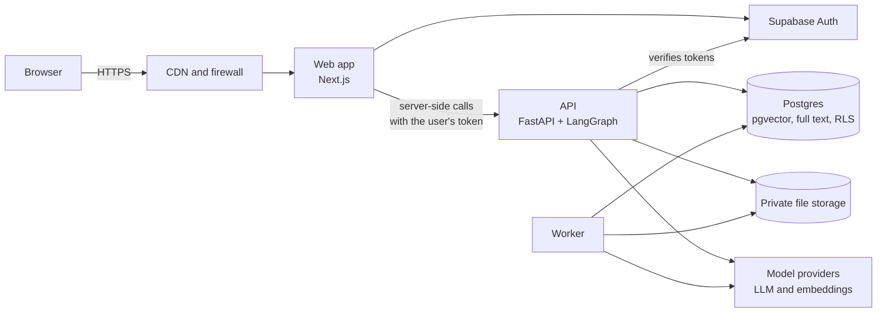
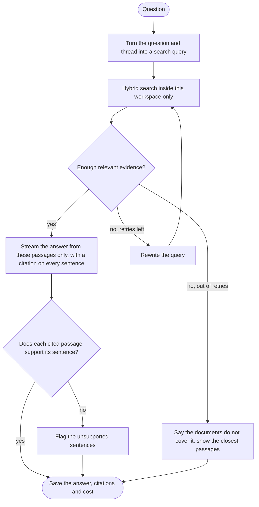

# Architecture

Status: draft 1, 2 November 2026. Decisions change through pull requests, and each change updates this file.

## Summary

A Next.js web app serves the pages and holds the user's session. When someone asks a question, the web server calls the Python API with that user's token. The API confirms who the user is and which workspace they may read, then runs a LangGraph agent. The agent searches that workspace's documents in Postgres, using vectors and keywords together, and asks a language model to answer from the passages it found and nothing else. The answer streams back as the model writes it, with a citation on every sentence. Once the answer is complete, a verification step checks each citation against its passage and flags any sentence the passage does not support. A separate worker process turns uploaded files into searchable passages in the background.

## Components

| Part | Job | Runs on |
| --- | --- | --- |
| Web app (`web/`) | Pages, forms, session cookies, per-IP rate limits, server-side calls to the API | Next.js on a free managed host with a CDN |
| API (`api/`) | Token checks, input validation, per-user rate limits, the agent, streaming answers | Python and FastAPI on a free host, packaged with Docker for development and CI |
| Agent | Turns the question into a search, retrieves, grades evidence, writes and verifies the cited answer | LangGraph, inside the API process |
| Worker | Parses, chunks, embeds and indexes uploaded files | Same codebase as the API. Free plans include no always-on background worker, so it runs inside the API server or as one function call per job |
| Database | Workspaces, documents, passages, vectors, jobs, threads, audit log | Supabase Postgres with pgvector |
| File storage | Original uploaded files | Supabase Storage, private bucket |
| Auth | Sign-up, sign-in, 2FA, password reset, Google sign-in | Supabase Auth |
| Model providers | Embeddings and answer generation | Chosen by evaluation (see Open decisions) |
| Observability | Logs, traces, errors, metrics, product analytics | Free plans chosen on Day 13 and Day 19 |

## How a question flows

1. The browser sends the question to our own web server. Same origin, so the browser makes no cross-origin call and CORS never comes into play.
2. The web server reads the session from an httpOnly cookie, applies per-IP rate limits, and calls `POST /v1/workspaces/{workspace_id}/ask` on the API with the access token.
3. The API verifies the token's signature, expiry, issuer and audience. It checks that the user belongs to the workspace and applies per-user rate limits.
4. Each database step (loading the thread, searching, saving the answer) runs in its own short transaction, which sets the user ID that row-level security policies read. No transaction stays open while the model writes, so a slow model call never holds a database connection.
5. The agent rewrites the question into a search query using the thread so far, runs hybrid search, grades the evidence, and either answers with citations or says the documents do not cover it.
6. The API streams the answer to the web server with Server-Sent Events, and the web server streams it on to the browser. A citation that points at anything outside this search's results is dropped before it reaches the browser.
7. When the answer is complete, the verification step checks each citation, and the API sends any flags as a final event. Then it stores the message, its citations and flags, token counts and cost.

## How a document flows

1. The browser asks for an upload slot. The API checks the user's role and the workspace's storage quota, then returns a short-lived signed URL for one file in a quarantine folder.
2. The browser uploads the file straight to storage with that URL. The file never passes through our web server, which matters because serverless hosts cap request bodies (Vercel at 4.5 MB).
3. The browser tells the API the upload finished. The API checks the real file type from its content: a PDF must start with `%PDF-`, a Word file must open as a valid DOCX package within size and entry limits, and Markdown, text and HTML must decode as UTF-8. A file that fails is deleted.
4. The API moves the file from quarantine to a random name in the private bucket, then inserts the document row and an ingestion job in one transaction.
5. The worker claims the job with `SELECT ... FOR UPDATE SKIP LOCKED`, which lets several workers pull jobs at once without blocking each other. The claim sets a lease. If a worker dies, its lease expires and another worker takes the job, so every step is idempotent and writes only while the worker still holds the lease.
6. The worker extracts text with page numbers, splits it into passages along headings, embeds the passages in batches, and writes them with their vectors and full-text index entries.
7. A failed step retries with exponential backoff and jitter. After 5 failed attempts the job moves to a dead letter state and the document shows a clear error.
8. When processing finishes, the document's status becomes `ready` and the workspace's corpus version goes up by one. Cached answers keyed to the old version stop matching, so no one sees a stale answer.

## The agent

We use a fixed graph instead of a free-roaming agent. Every path has a known maximum number of model calls, so cost and latency stay bounded, and we can test each node as a plain function. The retry loop runs at most twice.

Streaming forces a trade-off. People should see the first words within the 2.5 second target in the product spec, but checking whether a passage really supports a sentence takes another model call. So the cheap check runs during streaming (every citation must point at a passage this search returned), and the full check runs once the answer is complete. A sentence that fails is flagged on screen and logged for evaluation. If evals show flags are common, we switch to holding each sentence back until it passes.

Thread history lives in our own `threads` and `messages` tables, under row-level security, and the agent rebuilds its context from them for each question. We do not use LangGraph's Postgres checkpointer, because it creates its own tables outside our migrations and our row-level security.

## Data model, first draft

| Table | Holds |
| --- | --- |
| `workspaces` | Name, owner, corpus version |
| `memberships` | User, workspace, role (owner, admin or member) |
| `invitations` | Hash of the invite token, role, expiry |
| `documents` | Title, type, size, SHA-256 of the content, storage path, status, version |
| `chunks` | Passage text, page and section, token count, embedding vector, full-text vector |
| `jobs` | Kind, status, attempts, next run time, lock owner, lease expiry, last error |
| `threads`, `messages` | Conversations, plus model, token counts and cost per answer |
| `citations` | Which passages each answer cited, where, and whether verification flagged them |
| `feedback` | Thumbs up or down with an optional reason |
| `audit_events` | Who did what, and when |

Every table that belongs to a workspace has a `workspace_id` column, an index on it and a row-level security policy. Schema changes go through Alembic migrations, and we review them like code.

## Security model

Trust boundaries:

- The browser is untrusted. So is every uploaded document and every model output.
- The web server holds session cookies and calls the API on the user's behalf.
- The API trusts nothing it has not checked: token signature, expiry, membership, role and the shape of every input.
- The database enforces workspace isolation a second time with row-level security.

Tokens: Supabase Auth issues a short-lived access token and a refresh token. The web server keeps both in httpOnly, Secure, SameSite=Lax cookies, so JavaScript on the page, including any injected script, cannot read them. That stops token theft, but an injected script could still act inside the page while it runs, so the Content Security Policy below matters too. All Supabase Auth calls happen in server code, because Supabase's browser client needs cookies that JavaScript can read. The API verifies each access token's signature. We use Supabase's asymmetric signing keys, so the API only needs the public keys and key rotation needs no redeploy.

Authorization happens twice:

1. In the API. Every route that touches workspace data loads the user's membership for that workspace and checks the role the action needs.
2. In the database. Request handlers connect as a role that cannot bypass row-level security. Each transaction sets the current user ID with `set_config(..., true)`, which lasts only for that transaction. Policies show only rows from that user's workspaces. Migrations run under a separate owner role.

Privileged paths: a few jobs cannot run as one signed-in user. Each gets the narrowest access that works and lives in one module, and nothing outside this list gets extra access.

- The ingestion worker connects as its own role. Each of its transactions sets the current job's workspace ID, and the worker's policies allow only that workspace's rows.
- Accepting an invite runs through a `SECURITY DEFINER` database function that checks the invite token's hash and expiry before it adds the membership.
- Deleting an account or a workspace runs through `SECURITY DEFINER` functions that check the caller owns what they delete.
- The public demo reads one demo workspace through a read-only policy.
- The Supabase service role key appears only in the module that calls Supabase admin APIs, never in request handlers.

Prompt injection: documents can contain text written to manipulate the model. Retrieved passages go into the prompt inside marked blocks, with instructions that their contents are data. The model has no tools that send messages, browse or write anything. Answers render as sanitized markdown with no images and no raw HTML, and links may only point to our own citation pages, so an injected instruction cannot smuggle data out through an image or link address. A set of deliberately poisoned test documents runs in CI.

Content Security Policy: images load only from our own origin. Signed-in pages use script nonces, because they render per request anyway. Cached public pages use script hashes instead, because nonces would force every page to render per request.

Uploads: an allowlist of types checked by content, a 20 MB limit, single-use signed upload URLs into a quarantine folder, random storage names, a private bucket, short-lived signed URLs for viewing, and parsing in the worker with time and memory limits.

Secrets: environment variables in each environment and GitHub Actions secrets for CI and deploys. Never in git. Secret scanning runs on every push and pull request.

Abuse: CAPTCHA on sign-up, sign-in and password reset. The web server applies per-IP limits, because behind it the API only ever sees the web server's address. It takes the client IP from the header our host sets and ignores any value a client sends. The public demo allows 100 requests per hour per IP on its ask route and has a daily token budget, so its cost has a ceiling. Sign-up, sign-in and password reset get stricter limits, on top of Supabase Auth's own. Signed-in users get per-user limits in the API instead, because many people on one office or mobile network share an IP address, and a strict per-IP limit would lock them all out. Request size limits and timeouts on every outbound call.

## Decisions and trade-offs

| # | Decision | Why | What we give up | Revisit when |
| --- | --- | --- | --- | --- |
| 1 | One repository with `web/` and `api/` | One pull request can change both sides; one CI setup | CI has to run only the checks for the folders that changed | A second team owns one side |
| 2 | Python (FastAPI) for the API, Next.js for the web | The AI tooling we need (LangGraph, document parsers, eval tools) lives in Python; Next.js gives server rendering and fast pages | Two languages and two deploys | Not expected |
| 3 | LangGraph with a fixed graph | Bounded cost and latency, testable nodes, streaming built in | Less flexible than an open-ended tool-calling agent | Users need multi-step research across tools |
| 4 | pgvector inside the main Postgres | Data, vectors and permissions in one place: joins, transactions and row-level security work together, and a demo fits the free plan | A dedicated vector database scales further and handles filtered search more directly | Tens of millions of passages, or filtered searches get slow |
| 5 | Hybrid search (vectors plus full text) merged with reciprocal rank fusion | Vectors miss exact names, codes and acronyms; keywords miss paraphrases; fusion catches both | Two queries per search, a few milliseconds | Evals show one method alone scores the same |
| 6 | Citations point at stored passage IDs, checked cheaply while the answer streams and fully once it ends | Every citation is provable against text we stored, and the first words still arrive within the latency target | A reader can see an unsupported sentence for a moment before it is flagged, and the full check adds one fast model call | Evals show flags are common (then each sentence waits until it passes) |
| 7 | Supabase Auth | Password and Google sign-in, authenticator-app 2FA (included on the free plan) and CAPTCHA without writing auth code, next to our database | We build the workspace and team model ourselves. Leaked-password protection is a paid feature, so we add our own breached-password check | We need SSO or SAML |
| 8 | Backend for frontend: tokens in httpOnly cookies, and the browser never calls the API directly | Injected scripts cannot read tokens. The API sends no CORS headers, so browsers refuse cross-origin calls to it | One extra hop through the web server, which also has to pass streams through and apply per-IP limits | Third parties need direct API access (then we add API keys and a CORS allowlist) |
| 9 | Workspace isolation in the API and again in Postgres row-level security | A bug in one layer does not leak data | More SQL to write and test | Not expected |
| 10 | Job queue in Postgres using `SKIP LOCKED` | No extra service to run. The job is created in the same transaction as the document, so one cannot exist without the other | Lower ceiling than a dedicated broker, which only matters at thousands of jobs per second | Sustained high job volume |
| 11 | Server-Sent Events for streaming | One-way streaming over plain HTTP that passes through proxies and CDNs | Not two-way. The ask route is a POST, so the browser reads it with fetch, which never reconnects on its own. If a stream drops, the page reloads the saved answer or offers a retry | We add live collaboration |
| 12 | Managed hosting, no Kubernetes | The platform handles health checks, rolling deploys, TLS and scaling without an ops team | Less control and some lock-in. Free plans also sleep or cold-start when idle | Many services, or a platform team to run them |
| 13 | Public repository | Free branch rules, secret scanning, CodeQL and CodeRabbit's open source plan, and recruiters can read the code | Anyone can read the code, so security can never rely on hiding it (it never should) | Not expected |
| 14 | Evaluations run in CI | A prompt or retrieval change cannot quietly lower answer quality | Evals use the free model quota, so pull requests run a small set and the full set runs nightly | Not expected |

## Open decisions

The budget is zero, so every option below has a free plan. Before we commit to one, we re-read its terms and confirm it needs no payment card.

| Decision | Free options | How we decide | When |
| --- | --- | --- | --- |
| Answer model | Groq's free plan, whose terms forbid training on our inputs and outputs, and Cloudflare Workers AI, which gives 10,000 free Neurons a day and does not train on customer content | Eval scores, speed, and whether the free quota covers the demo | Day 10 |
| Embedding model | A small open model running on our own server, or Cloudflare Workers AI embeddings | Recall@8 on our eval set, speed, memory use on a free host | Day 8 |
| API hosting | Render's free web service (sleeps after 15 minutes without traffic, takes about a minute to wake, offers no free background workers) or Python functions on Vercel Hobby (up to 5 minutes per call) | Streaming support, where the worker can run, wake-up time | Day 22 |
| Web hosting | Vercel Hobby (free for personal, non-commercial projects) or Cloudflare Pages | Preview deploy per pull request, CDN, plan terms | Day 22 |
| Database | Supabase Free | 500 MB holds roughly tens of thousands of passages. A project pauses after a week without activity and has no automatic backups, so we run our own backups, and Day 22 settles how the demo stays awake | Day 22 |
| Sign-in emails | Supabase's built-in email only reaches the project's own team, at two messages an hour, so real users need an SMTP service. Without a domain, one free option is a dedicated Gmail account sending over SMTP | Delivery tests to Gmail and Outlook inboxes | Day 6 |
| Domain | A free eu.org domain, or the host's free subdomain such as whence.vercel.app. Reported eu.org waits range from hours to over a year. is-a.dev is out, because its terms bar sites behind a login and apps similar to ChatGPT or Claude | Whether eu.org approves in time | Apply on Day 3, decide on Day 23 |

Free model tiers need care: some, such as Gemini's and Mistral's, may use what you send to train their models. Whence uses only providers whose terms rule that out, in production and in the public demo alike, because demo visitors type their own questions.

## What we deliberately do not build yet

Kubernetes, Helm, multi-region deployment, sharding, read replicas, a service mesh, gRPC, and distributed transactions. Each one solves a problem Whence does not have at this size. [engineering-concepts.md](engineering-concepts.md) explains what we do instead and what would make each one worth adding.
